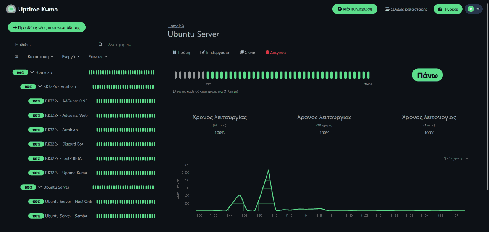
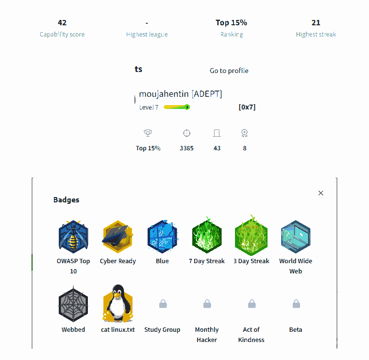

# Cybersecurity Homelab
### Hands-on network security · Linux administration · monitoring · automation

A **real, continuously evolving home lab** that I build, operate and test to develop practical skills in **offensive security, networking, Linux systems and infrastructure reliability**.

My approach is simple: **build it, test it, break it safely, understand the evidence, and improve it.** This repository documents implemented work and lessons learned—not just a list of tools I have installed.

> **Scope:** All security tests are carried out on systems I own, explicitly authorized targets, or dedicated learning platforms. This is a sanitized public portfolio. Real infrastructure settings and secrets are intentionally excluded.

---

## At a glance

| Area | Hands-on work |
|---|---|
| **Security testing** | Nmap discovery and service enumeration, SMB/enum4linux analysis, Bettercap lab experiments, TryHackMe exercises |
| **Networking** | Tailscale overlay networking, multiple interfaces/subnets, DNS/DHCP, packet-visibility troubleshooting |
| **Linux administration** | Ubuntu Server, Armbian, SSH hardening, Fail2ban, systemd services and timers |
| **Service monitoring** | Uptime Kuma, ping/TCP/DNS/HTTP/push checks, Discord notifications, external heartbeat |
| **Automation and backups** | Python/Bash workflows, SQLite integrity checks, encrypted off-site backups with rclone and Backblaze B2 |

**Currently running:** two always-on Linux machines with service-specific monitoring.  
**Used on demand:** Kali Linux and other client/test devices.  
**Focus:** practical, entry-level cybersecurity / penetration-testing and Linux/networking skills.

## Architecture

~~~mermaid
flowchart LR
    K["Kali Linux Authorized security tests"]
    U["Ubuntu Server Samba · SSH · lab DNS/DHCP"]
    R["RK322x / Armbian AdGuard Home · Uptime Kuma Automation services"]
    T["Tailscale Private overlay"]
    D["Discord Alerts"]
    B["Backblaze B2 Encrypted backups"]
    H["Healthchecks.io External heartbeat"]

    K -->|"Lab discovery / enumeration"| U
    K --- T
    U --- T
    R --- T
    R --> D
    R -->|"rclone crypt"| B
    R --> H
~~~

The diagram shows **functional relationships**, not live IP addresses, firewall rules or a complete network map.

**Architecture walkthrough:** [docs/architecture.md](docs/architecture.md)

**DNS filtering evidence (2026-11-18):** In one 24-hour AdGuard Home dashboard snapshot, **7,065 DNS requests** were recorded, **935** blocked by filters (**13.23%**), with an average displayed processing time of **5 ms**. These are observed dashboard metrics, not verified malicious-threat counts. [Read the sanitized evidence](docs/evidence/adguard-dns-filtering-2026-11-18.md).

## Projects and implemented work

### 01 — Build and operate a low-power Linux homelab

Repurposed an ARM-based RK322x device as a lightweight, always-on service node, alongside an Ubuntu Server running on older laptop hardware.

**Implemented**
- Linux service hosting and troubleshooting on resource-constrained devices.
- Tailscale-based private connectivity between lab systems.
- AdGuard Home for DNS filtering on selected private-network clients.
- Samba, SSH and dnsmasq services on the Ubuntu Server.
- systemd management of persistent and on-demand services.
- SSH hardening and a configured Fail2ban SSH jail; verified service/jail configuration, with end-to-end ban testing still to be documented.

**What this demonstrates:** working with actual hardware constraints, understanding services beyond installation, debugging connectivity and validating security controls.

### 02 — Monitoring and alerting across two Linux machines

Deployed **Uptime Kuma 2.x** on the ARM node as a native Node.js/systemd service, chosen to keep overhead manageable.

**Implemented and checked**
- **Ping:** host availability.
- **TCP:** SSH, Samba and local service listeners.
- **DNS:** AdGuard resolver behavior.
- **HTTP:** AdGuard web interface.
- **Push:** small, scheduled service-health checks for background bots.
- **Discord:** monitoring and backup-failure notifications.
- **External heartbeat:** a separate liveness signal for the Armbian monitoring node.

This work also involved troubleshooting the difference between monitor state, group initialization and computed uptime statistics.

**Case study:** [Monitoring and reliability](docs/monitoring.md)

**Redacted dashboard evidence (Uptime Kuma):**

*Actual homelab screenshot with browser address bar and a private host alias removed. The 100% values reflect the displayed measurement window at capture time, not a long-term uptime guarantee.*

### 03 — Verified, encrypted off-site backups

Built scheduled backup workflows for selected stateful workloads on the ARM node.

**Implemented and checked**
- Consistent SQLite snapshots via SQLite's Online Backup API.
- Database integrity validation before archiving.
- Compressed local backups with retention.
- Client-side encrypted off-site storage using **rclone crypt + Backblaze B2**.
- Remote file verification after upload.
- systemd timers and failure-notification paths.

**Verified:** backup creation, integrity checks and remote comparison.  
**Still to validate:** a complete isolated restore rehearsal. I do not present backups as proven recoverable until that test is completed.

**Case study:** [Backups and recovery readiness](docs/backups-and-recovery.md)

**Execution evidence:** [Redacted successful SQLite backup and remote comparison (2026-11-18)](docs/evidence/uptime-kuma-backup-verification-2026-11-18.md) · [systemd timer automation audit (2026-11-18)](docs/evidence/systemd-automation-audit-2026-11-18.md)

### 04 — Authorized network reconnaissance and SMB analysis

Used **Kali Linux, Nmap and enum4linux** to enumerate an intentionally configured Ubuntu/Samba lab target.

**Observed and analyzed**
- Live-host discovery, exposed ports and reported service versions.
- SMB behavior, including an accessible test share and anonymous-session findings in the lab configuration.
- Server-side logs to help validate probe activity.
- Why some Windows-oriented SMB vulnerability-script findings were not applicable to a Linux/Samba service.

**Lesson:** enumeration output is evidence to investigate, not proof of exploitation.

### 05 — Controlled packet analysis and MITM experiments

Used **Bettercap** for local discovery and target-scoped ARP-spoofing experiments on owned lab endpoints. Investigated the limits of passive observation on switched Ethernet and across a VPN overlay.

**Lesson:** to understand what a capture can prove, first understand **where** it was taken and how packets traverse the network.

### 06 — Defensive testing and security investigations

- **SSH / Fail2ban:** compared the configurations of two Linux hosts, discovered a mismatch between a non-default SSH listener and the Fail2ban nftables action, corrected the jail setting, and verified the effective action port. No end-to-end ban has yet been demonstrated.

  **Evidence:** [Two-host SSH hardening and Fail2ban configuration audit (2026-11-18)](docs/evidence/ssh-hardening-fail2ban-2026-11-18.md)
- **TryHackMe training:** practiced Blue / MS17-010 (including a SYSTEM-level context in the lab), Active Directory OU/GPO/delegation tasks, Windows administration, Telnet/web-service investigation, OSINT and SSTI exploration. Official completion status differs by exercise and is documented separately.
- **Suspicious web-flow analysis:** inspected DNS, HTTP redirects, TLS behavior and browser API requests while distinguishing actual observations from unverified claims about data submission.

**Security lab notes:** [docs/security-lab.md](docs/security-lab.md) · **[TryHackMe activity inventory](docs/tryhackme-learning.md)**

---

## Tooling and technologies

| Category | Tools / concepts used |
|---|---|
| Operating systems | Kali Linux, Ubuntu Server, Armbian, Windows |
| Reconnaissance | Nmap, enum4linux, service analysis |
| Network testing | Bettercap, ARP, packet inspection, LAN switching |
| Network services | Samba, SSH, dnsmasq, AdGuard Home, Tailscale |
| Hardening and logs | OpenSSH, Fail2ban, systemd journal |
| Monitoring | Uptime Kuma, Healthchecks.io, Discord webhooks |
| Scripting and operations | Python, Bash, systemd units/timers, SQLite |
| Backup/storage | SQLite Online Backup API, rclone crypt, Backblaze B2 |
| Documentation | Markdown, Mermaid diagrams, Git/GitHub |

I am documenting **things I have actually used or investigated**, not claiming advanced mastery of every item.

## What running the lab has taught me

**A service that is reachable is not necessarily healthy.** ICMP, TCP, DNS and HTTP checks answer different questions.

**A successful backup upload is not a tested restore.** Integrity checking and recovery drills belong to different stages of disaster-recovery readiness.

**A scanner finding is not a confirmed vulnerability.** Operating system, service implementation and corroborating logs matter.

**A VPN does not make all traffic visible.** Overlay networking and switching change packet-observation points.

**Resource limits influence architecture.** On small ARM hardware, systemd timers and lightweight services may be more appropriate than leaving additional stacks running continuously.

## Evidence, transparency and safety

This repository separates **implemented work** from **future plans**. Detailed evidence is written up as case studies; raw infrastructure configuration, credentials, real addresses, sensitive logs and backup archives remain private.

For the public documentation rules and screenshot-redaction checklist, see [Publication safety](docs/publication-safety.md).

## Documentation index

| Document | Contents |
|---|---|
| [Architecture](docs/architecture.md) | Components, logical network flows, boundaries and scope |
| [Security lab](docs/security-lab.md) | Practical tests, observations, limitations and lessons |
| [TryHackMe learning](docs/tryhackme-learning.md) | Training-room exercises, verified task progress and completion caveats |
| [Monitoring](docs/monitoring.md) | Live checks, push monitoring, alerts and failure domains |
| [Backups & recovery](docs/backups-and-recovery.md) | Verified encrypted backup pipeline and restore plan |
| [Publication safety](docs/publication-safety.md) | What can be shared without exposing private systems |

## Roadmap

These items are **planned**, not represented as completed:

- [ ] Perform and document an isolated restore test from encrypted off-site storage.
- [ ] Add redacted screenshots and sample evidence for selected case studies.
- [ ] Create reproducible, sanitized examples of selected systemd checks and monitoring workflows.
- [ ] Expand structured write-ups as new TryHackMe and lab exercises are completed.
- [ ] Maintain a separate private inventory of hosts, exact settings and recovery procedures.

## TryHackMe profile — screenshot-verified snapshot (2026-11-18)

[TryHackMe — moujahentin](https://tryhackme.com/p/moujahentin) · **Top 15%** · **Level 7 (Adept)** · **3,385 points** · **8 earned badges** · **43 shown on the room counter** · **21-day highest streak**.

These are dated values transcribed from profile/dashboard screenshots supplied by the account owner, **not live API data**. The eight visible badges include **Blue**, **OWASP Top 10**, **Cyber Ready** and **cat linux.txt**. The full list of individual completed-room names has not yet been supplied.

**[Profile achievements and evidence limitations](docs/evidence/tryhackme-profile-2026-11-18.md)** · [Training activity log](docs/tryhackme-learning.md)

## Related public work

- [GitHub profile / portfolio](https://github.com/moujahentin)
- [Personal Python projects and desktop automation](https://github.com/moujahentin/personalProjects)
- [Multi-tenant SaaS architecture case study](https://github.com/moujahentin/multi-tenant-saas-case-study)

Those are separate projects; proprietary implementations and unrelated private infrastructure are not included here.

---

**Goal:** continue growing from guided labs into evidence-based, reproducible security testing and strong operational fundamentals, with a focus on entry-level cybersecurity opportunities.

*Built, tested and documented in an authorized personal lab.*
