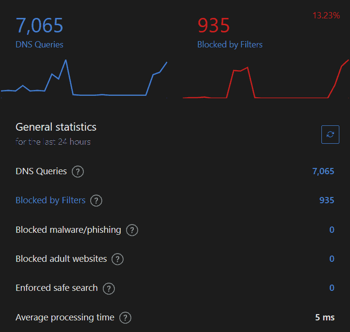

# AdGuard Home — DNS filtering evidence (18 November 2026)

**System:** AdGuard Home running on a low-power Armbian homelab node  
**Evidence:** Screenshot of the application's dashboard supplied by the system owner  
**Observation window:** The dashboard's **last 24 hours** at capture time

## Snapshot results

| Metric | Observed value |
|---|---:|
| DNS queries processed | **7,065** |
| Queries blocked by filters | **935** |
| Filtering rate | **13.23%** |
| Average processing time | **5 ms** |
| Blocked malware/phishing counter | **0** |
| Blocked adult-websites counter | **0** |

The numbers come from the owner-supplied dashboard screenshot. The 935 filter hits represent **blocked DNS requests**, not 935 distinct threats or confirmed malicious hosts. Likewise, a zero malware/phishing-specific counter is **not** evidence that no malicious domains were queried.

## Redacted screenshot evidence

*This is a crop of the actual owner-supplied dashboard, not a simulated dashboard. The browser URL, individual client addresses and query/domain panels are outside the crop. The displayed 24-hour statistics are the original observed values.*

## Implementation context

- AdGuard Home runs as a DNS filtering service on an always-on Armbian device.
- Selected clients use it over the private network, including a Tailscale-enabled endpoint.
- Uptime Kuma checks both DNS resolution and the AdGuard web interface independently.
- The deployment is scoped to configured clients; it is **not** claimed to filter every device on the household network.

## Validation and boundaries

The screenshot is evidence of the UI reporting DNS workload and filter matches during the specific observation window. It does **not** prove which queries originated from which device, guarantee latency for all requests, or establish that blocklists prevent all phishing or malware.

The original screenshot also displayed individual client IP addresses, a private network address in the browser URL, and per-domain usage patterns. Those details are intentionally **not reproduced** in this public document.

A cropped proof image may be published separately after removing all client identifiers and query/domain panels. Nothing in this write-up should be interpreted as a live service endpoint or complete network map.

## Practical takeaway

This project combines DNS administration with operational validation: evaluate aggregate query metrics, avoid attributing all filter hits to malicious activity, monitor actual DNS response behavior, and maintain sensible boundaries for public evidence.

[Monitoring case study](../monitoring.md) · [Architecture](../architecture.md) · [Portfolio](../../README.md)
