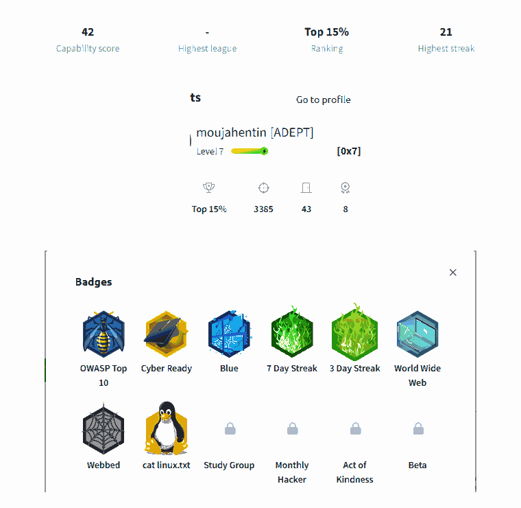

# TryHackMe profile — achievements evidenced on 2026-11-18

**Public profile:** [moujahentin on TryHackMe](https://tryhackme.com/p/moujahentin)  
**Evidence date:** 2026-11-18  
**Source:** Five screenshots supplied by the profile owner (profile, badges dialog, dashboard and learning roadmap). This is a **dated snapshot**, not a live feed or independently authenticated TryHackMe API export.

## Cropped source screenshots

*This image combines cropped excerpts of the five screenshots supplied by the profile owner. The screenshots were cropped to exclude browser tabs, navigation details and unrelated content. The statistics and badges were not altered. The result is a dated evidence collage, not a live TryHackMe widget.*

## Profile statistics visible in the screenshots

| Metric | Visible value | Interpretation |
|---|---|---|
| Ranking | **Top 15%** | TryHackMe profile ranking at screenshot time |
| Level | **7 — Adept** | Shown on the logged-in dashboard |
| Points | **3,385 / 4,000** | Current level's displayed progress |
| Capability score | **42** | Profile capability score, not a professional certification |
| Highest streak | **21** | Highest activity streak shown |
| Badges earned | **8** | Dashboard badge counter and colored earned badges |
| Room counter | **43** | Number shown beside the dashboard's room/door icon; individual room names not supplied |
| Yearly activity | **652 events** | Profile's “events in the last year” at screenshot time |
| Account since | **December 2024** | Profile join date |

All values may change over time; this document does not present them as permanent.

## Eight visibly earned badges

The badges dialog displays these **eight colored/unlocked badges**:

1. **OWASP Top 10**
2. **Cyber Ready**
3. **Blue**
4. **7 Day Streak**
5. **3 Day Streak**
6. **World Wide Web**
7. **Webbed**
8. **cat linux.txt**

Gray padlock badges shown nearby are **not claimed**.

### What the Blue badge establishes

The official **Blue** badge is visible among the unlocked badges. This provides stronger evidence for the Blue room achievement than a retrospective activity description alone. It does not by itself establish proficiency beyond the relevant TryHackMe learning achievement.

## Learning-path activity visible in the roadmap

The screenshots also show a few **in-progress** paths:

| Path | Visible progress |
|---|---:|
| Pre Security | 55% |
| Cyber Security 101 | 39% |
| SOC Level 1 | 1% |
| Security Engineer | 6% |
| Red Teaming | 3% |

“Jr Penetration Tester” is marked as the **latest enrolled path**. No completed path or certification is inferred from enrollment, and the visible progress values do not establish a certificate.

## Evidence boundaries

- The screenshots show profile-level statistics and a subset of badges; they do **not** include a named list of every one of the 43 room-counter entries.
- Previously discussed OSINT, Active Directory, Telnet and SSTI exercises remain recorded as activities unless the individual completion is separately confirmed.
- The screenshot evidence was supplied by the account owner, not fetched from an authenticated TryHackMe API.
- No private labs, machine IPs, session details or credentials are published.

The official [TryHackMe profile](https://tryhackme.com/p/moujahentin) is linked as the primary public reference.

[TryHackMe learning log](../tryhackme-learning.md) · [Portfolio README](../../README.md)
