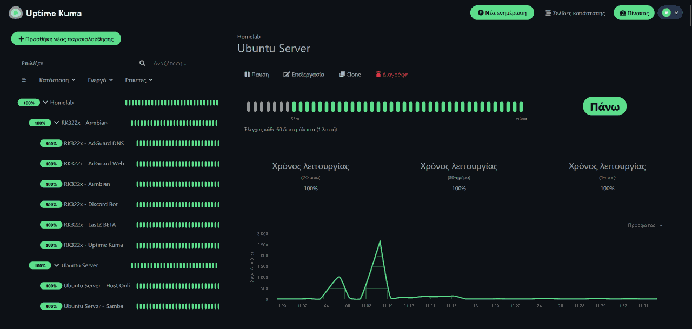

# Monitoring and reliability engineering

## Goal

Build useful service-level visibility for a **small, always-on homelab**, while keeping CPU and memory overhead reasonable on repurposed ARM hardware.

**Implemented:** Uptime Kuma 2.x runs natively under systemd on the low-power Armbian node. It monitors that host plus a second always-on Ubuntu Server through private connectivity.

## Monitors in place

| Component | Check type | What the check actually proves |
|---|---|---|
| Armbian host | Ping | Host/network reachability |
| Uptime Kuma endpoint | TCP | Monitoring web listener is reachable |
| AdGuard Home DNS | DNS | DNS query succeeds through the configured resolver |
| AdGuard Home web interface | HTTP | Web endpoint responds |
| Discord automation service | Push | Local scheduled health check reports service health |
| LastZ beta automation | Push | Separate scheduled check reports the beta instance's health |
| Ubuntu Server host | Ping | Remote host is reachable |
| Ubuntu SSH | TCP | SSH listener responds |
| Ubuntu Samba | TCP | SMB listener responds |

The monitors are organized in nested groups for easier navigation. A listening TCP socket is **not** proof that an application transaction will succeed; deeper checks can be added when there is a real operational need.

## Design choices

### Lightweight runtime

- Native Node.js installation rather than a container stack on the constrained ARM node.
- systemd manages automatic startup and restart behavior.
- A service memory limit protects the rest of the host.
- The deployment uses SQLite, with application-aware database backups.

### Process-aware push checks

Some workloads are background workers without a suitable HTTP endpoint. Instead of exposing an unnecessary public API, local systemd timers run small checks and send **Push** heartbeats to Uptime Kuma. The push URLs are kept in restricted local files, not committed to Git.

A missed heartbeat can reveal a stopped or failing worker. A push monitor only provides as much assurance as its actual checking script; blindly sending periodic pings would be weaker.

### Alerting

- Discord receives Uptime Kuma notifications for the homelab.
- Monitoring groups and application instances are named clearly to avoid confusing beta workloads with any separate future production deployment.
- Failed backup jobs can also trigger their own Discord alert path.

### External liveness for the monitoring node

The Armbian box also sends an **outbound heartbeat** to Healthchecks.io. This provides a separate signal if the device or the on-box monitoring stack becomes unavailable.

**Scope limitation:** the external heartbeat demonstrates that the sender job ran. It is not a complete independent functional test of every service. The Ubuntu host is checked by Uptime Kuma, not by a separate external cloud heartbeat.

## A subtle issue encountered: group initialization

Creating a parent group before its children are ready can produce transient **PENDING** events, including messages such as "Group empty" and "Child inaccessible". During initial setup these events affected the displayed 24-hour group availability even though the established child monitors were healthy.

This taught me to distinguish:
- Setup-time state from an actual service outage.
- Group aggregation from individual service checks.
- Raw heartbeat history from precomputed availability statistics.

For operational reporting, genuine failures should be preserved rather than erased to make a dashboard look green. The right long-term approach is to interpret status windows and initialization behavior correctly.

## Dashboard evidence

*Screenshot from a running deployment. The browser URL and a private host alias have been removed before publication. Green status and 100% figures describe the displayed snapshot/window only, not an uptime SLA.*

## What I verified

- The Uptime Kuma process could start via systemd and serve its interface.
- Host, DNS, HTTP, TCP and push monitors reported healthy against the intended targets.
- Discord alerts were received through the configured notification paths.
- The local backup job passed SQLite integrity checks and remote file verification.
- The system remained within the constrained node's operating memory budget during observed checks.

These are observations from a functioning lab, **not** an SLA, security audit, or high-availability claim.

## Future work

- Add application-level transaction checks if specific workloads require them.
- Perform and document a complete restore rehearsal.
- Introduce error-budget / incident notes as the service set grows.

[See backup workflow](backups-and-recovery.md) · [See architecture](architecture.md) · [Back to README](../README.md)
